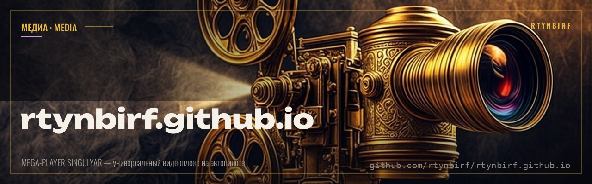
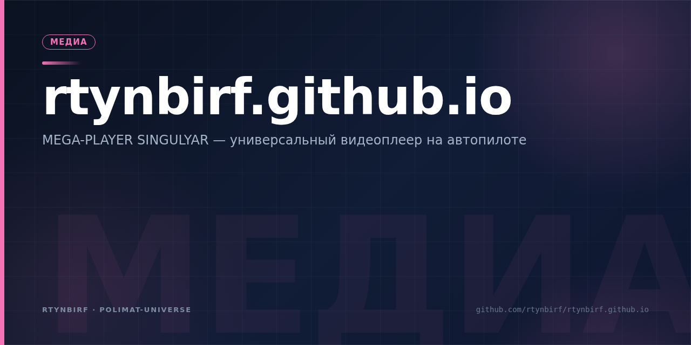

  

# ЛАКОРНИЯ · MEGA-PLAYER SINGULYAR

   

Одностраничный PWA-плеер сайта-профиля `rtynbirf.github.io`: универсальный
автопилот-видеоплеер с офлайн-режимом.

## Что здесь

- `index.html` — вся страница (монолит: разметка, стили, логика);
- `vendor/webtorrent.min.js` — вендоренная библиотека WebTorrent для P2P-стриминга.

## Запуск

Статический сайт: достаточно открыть `index.html` в браузере или зайти на
<https://rtynbirf.github.io/>. Сборка не требуется.

## Связь с экосистемой

Плеер — витрина экосистемы СИНГУЛЯР (основной репозиторий: `rtynbirf/singulyar`).
Правила игры аккаунта — в `rtynbirf/repo-doctrine`.

## Вендоренные библиотеки

- `vendor/webtorrent.min.js` — бандл WebTorrent для P2P-стриминга.
  SHA-256: `4d37412215d3812488da55b559e1f8f91e92c5424b4f2d4567331f972ef6f1f1`
  (214 835 байт). Точная версия сборки бандлом не заявлена; единственная
  версия-строка внутри кода — `2.5.1` (вероятная версия библиотеки, не подтверждена).
  При обновлении брать официальный бандл со страницы релизов
  <https://github.com/webtorrent/webtorrent/releases> и обновлять хеш в этом разделе.
