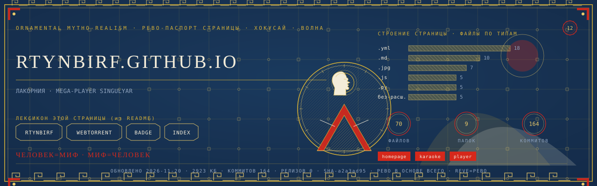

  

<!--ФОРЖ:МУЗА:НАЧАЛО-->

  
   
  

<!--ФОРЖ:МУЗА:КОНЕЦ-->

<!--ФОРЖ:ПАСПОРТ:НАЧАЛО-->

  

| ФАЙЛОВ | ПАПОК | КОММИТОВ | ОБНОВЛЕНО | РЕЛИЗОВ |
|---:|---:|---:|---|---:|
| 60 | 8 | 124 | 2026-11-19 | 0 |
<!--ФОРЖ:ПАСПОРТ:КОНЕЦ-->

# ЛАКОРНИЯ · MEGA-PLAYER SINGULYAR

   

Одностраничный PWA-плеер сайта-профиля `rtynbirf.github.io`: универсальный
автопилот-видеоплеер с офлайн-режимом.

## Что здесь

- `index.html` — вся страница (монолит: разметка, стили, логика);
- `vendor/webtorrent.min.js` — вендоренная библиотека WebTorrent для P2P-стриминга.

## Запуск

Статический сайт: достаточно открыть `index.html` в браузере или зайти на
<https://rtynbirf.github.io/>. Сборка не требуется.

## Связь с экосистемой

Плеер — витрина экосистемы СИНГУЛЯР (основной репозиторий: `rtynbirf/singulyar`).
Правила игры аккаунта — в `rtynbirf/repo-doctrine`.

## Вендоренные библиотеки

- `vendor/webtorrent.min.js` — бандл WebTorrent для P2P-стриминга.
  SHA-256: `4d37412215d3812488da55b559e1f8f91e92c5424b4f2d4567331f972ef6f1f1`
  (214 835 байт). Точная версия сборки бандлом не заявлена; единственная
  версия-строка внутри кода — `2.5.1` (вероятная версия библиотеки, не подтверждена).
  При обновлении брать официальный бандл со страницы релизов
  <https://github.com/webtorrent/webtorrent/releases> и обновлять хеш в этом разделе.

## Карта файлов

- `lacornia.html` — ЛАКОРНИЯ · МЕГАМЕТАПЛЕЕР: каталог лакорнов BL/GL, открытая сцена для любой ссылки и индекс студий мира; всё в одном окне, офлайн после первого визита.
- `elevator-26.html` — ЭЛЕВАТОР-26: спуск на Social-превью за одну минуту (страница-помощник).
- `assets/hero.jpg`, `assets/covers/*.jpg` — обложки витрин (cell-swarm, neutral-browser, polymath-gen, singulyar, tools-atlas, voice-atlas).
- `manifest.webmanifest`, `icon-192.png`, `icon-512.png` — оболочка PWA: офлайн-режим и установка на домашний экран.

## Дом

- Ядро дома — [polymath-core](https://github.com/rtynbirf/polymath-core); живой реестр аккаунта — [index](https://github.com/rtynbirf/index).

<!--ФОРЖ:ПОДВАЛ-->
---

  ◆ картина и штандарт — ручная ковка <a href="https://github.com/rtynbirf">КУЗНИ ПОЛИМАТ</a> · ЧЕЛОВЕК=АККАУНТ=PID1 ◆

